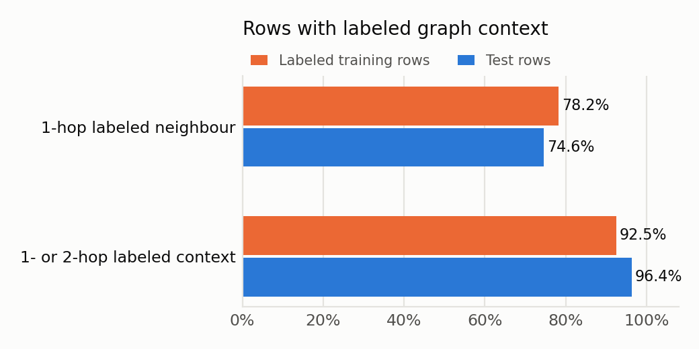
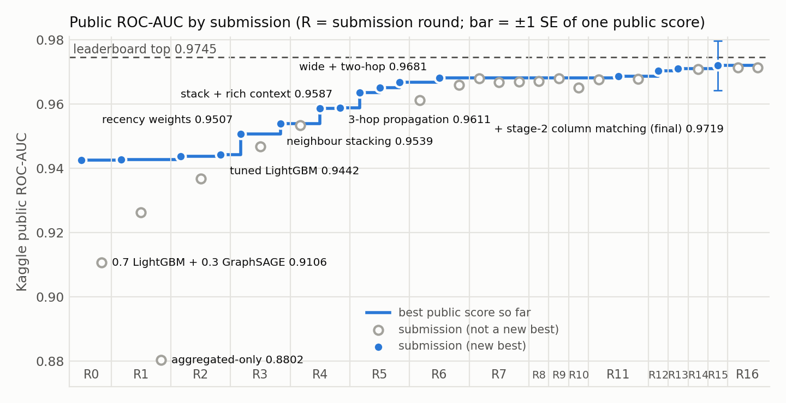

# Detecting Illicit Bitcoin Transactions with Label-Consistent Graph Stacking

**BT4012 In-class Kaggle Competition 2026 · e1304439** · Code: [github.com/emmyyyli/BT4012-Kaggle-Competition](https://github.com/emmyyyli/BT4012-Kaggle-Competition) (submission notebook `e1304439.ipynb`)

## 1. Introduction

Criminals use Bitcoin to launder money and pay for illegal goods. The competition asks for a
model that ranks Bitcoin transactions by their probability of being illicit. The data is a
Bitcoin transaction graph: each node is a transaction described by 165 anonymised features,
and each edge is a payment flow, where an output of one transaction is spent by another.
Models train on time steps 1–35 and are scored by ROC-AUC on the later steps 36–49. This
mirrors anti-money-laundering (AML) work: investigators need a risk ranking that catches
illicit flows early without flooding them with false alarms.

The problem has three properties, and each one shaped the approach:

- **Scarce, imbalanced labels.** Only 31,235 of 141,772 training transactions are labeled,
  and 11.7% of those are illicit. Supervised learning therefore uses labeled rows only, with
  balanced class weights.
- **Temporal drift.** The test period lies in the future; a classifier separates training
  rows from test rows with AUC ≈ 1.0 from the features alone. Validation is therefore always
  forward in time, training is weighted toward recent steps, and `time_step` is never a
  model input.
- **Graph structure with missing context.** Neighbouring transactions are informative, but in
  the test period most neighbours have no features. Every graph feature is therefore built
  from information that exists in the same form at training and prediction time.

The final model is a two-stage LightGBM stack. A first model scores each transaction from its
own features; a second model adds summaries of its neighbours in the payment graph. These
summaries use only *labeled* neighbours, the only transactions with features in both the
training and test periods, so they are computed the same way at training and prediction time.
No transaction's own label is used to build its features. The model raised the public
ROC-AUC from 0.94246 (first submission) to **0.97190**.

## 2. Methodology

### 2.1 Data preprocessing and feature engineering

**Audit.** The supplied features have no missing values and no duplicate IDs. Though
anonymised, they form two blocks: features correlate more within `feat_1`–`feat_93` and within
`feat_94`–`feat_165` (mean |r| 0.12 and 0.07) than across them (0.04), and the second block
drifts far more. We label them "local" and "aggregated" (the usual layout of transaction-graph
data, where the second block summarises the neighbourhood); the data supports two blocks, not
this meaning, and the final model uses all 165 features. Rows labeled `none` (110,537) were
treated as **unlabeled, not licit**. Using them as pseudo-labels lowered time-forward AUC by
about 0.03, because unlabeled transactions are not a random sample of labeled ones.
`time_step` is used only to split data. As a feature it lowered long-horizon AUC
(0.878 vs 0.884), and trees cannot extrapolate a counter to unseen steps.

**The decisive finding: the test period has blank neighbourhoods.**

- **How it was found:** matching edge-list IDs to the feature tables left 46,668 graph nodes
  with no features, all in steps 36–49. Test rows are scored against labels, so they are that
  period's *labeled* transactions; the blank nodes are its unlabeled ones, which in training
  appear as `none` rows *with* features.
- **What it means:** 65.6% of test-node edges lead to a featureless node, against 0% in
  training, so the same neighbourhood looks complete in training and mostly blank at test.
- **Why all neighbours cannot be used:** a model that learns from complete neighbourhoods
  meets different inputs at test time. Our GraphSAGE blend, which read all neighbours,
  dropped the public score from 0.94246 to 0.91059.
- **How it is managed:** graph features use only labeled neighbours, which have features in
  both periods, and two-hop walks pass *through* blank nodes to reach labeled ones (below).

**Feature drift.** Medians of 19.4% of the aggregated features shift by more than one
interquartile range from training to test, against 9.7% within the training period. Local
features barely move (1.1%). An aggregated-only model scored 0.880 on Kaggle. Removing the
five most-drifted features was neutral (0.94365 vs 0.94417), and correlated-cluster ablation,
SHAP-stability subsets and adversarial feature dropping gave no gain, so all 165 were kept.

**Label-consistent graph features.**

Labeled transactions exhibit homophily: a labeled neighbour of an illicit transaction is
illicit 57.4% of the time, against an 11.7% base rate. A transaction's *neighbours* are the
transactions linked to it by a payment, either funding it (incoming) or spending its outputs
(outgoing); each link is one *hop*, so two-hop neighbours are reached through an intermediate
transaction. Graph context is built only from labeled neighbours, the only transactions with
features in both periods, and never from a transaction's own label, so coverage is similar in
training and test (Figure 1). Two-hop walks may pass *through* featureless intermediates, which
extends context to 96.4% of test rows. Features, each added as a separately tested step:

1. **Neighbour scores:** mean, max, incoming-mean and outgoing-mean of stage-1 predictions over
   labeled neighbours.
2. **Neighbourhood structure:** in/out degree, plus the number and share of labeled neighbours.
3. **Neighbour feature statistics:** mean, max, std, incoming-mean and outgoing-mean over
   labeled neighbours of the 25 most influential supplied features, ranked by test-row SHAP of
   the base model (no labels used).
4. **Two-hop context:** walk-weighted means of stage-1 scores and the same 25 features over
   labeled nodes two hops away (first 5 features, later all 25).
5. **Payment-chain shape** (label-free, full edge list): longest payment path into and out of
   the transaction, and the length of the unbroken *peeling chain* around it (one funder, at
   most two spenders), a classic laundering pattern. Each time step is exactly one connected
   component, so component-level counts were excluded: they would encode the time step.

<figure><figcaption><b>Figure 1.</b> Share of rows with labeled graph context. The one-hop rule keeps training and test comparable; two-hop walks through featureless nodes reach 21.8% of test rows that have no labeled neighbour (14.3% in training).</figcaption></figure>

### 2.2 Model development and validation

**Base learner.** Both stages use LightGBM, a gradient-boosted decision-tree model. It builds
trees one after another, each correcting the errors of those before it, and sums their
outputs into an illicit probability. Settings were chosen by an Optuna search (40 trials)
scored on forward validation windows. The search chose **500 small trees with at most 9
leaves each**: every tree splits transactions into at most 9 groups, so it can only capture
simple feature interactions, and a low learning rate (0.025) makes each tree a small
correction. Every search, including XGBoost and CatBoost, preferred such shallow trees,
because simpler patterns survive the drift into the test period better. The other tuned
settings (minimum leaf size, feature and row sampling per tree, L2 penalty) add the same kind
of regularisation. Because stage 2 has twice as many columns (330), its column share is halved
so each tree still sees about 106 columns. Illicit rows are upweighted so both classes count equally (about 7.6× per
illicit row); ROC-AUC needs no decision threshold, so no resampling was needed.

**Stacking without leakage.** The model is trained in two stages:

1. **Stage 1** scores every transaction from its own 165 features. No training row may be
   scored by a model that has seen its label, so steps 1–35 are split into five blocks of
   consecutive steps and each block is scored by a model trained on the other four. Test
   rows get the average of those five models' scores, so both are scored the same way.
2. **Stage 2** adds the graph features of Section 2.1, built from these scores, and refits
   LightGBM on all of them.
3. **Weights:** every training row counts more if it is recent (2^((t − 35)/14): step 35
   counts 1, step 21 counts 0.5) and if it resembles the test period. The second weight
   comes from a classifier trained to tell training rows from test rows: rows it mistakes
   for test rows count more (√(p/(1 − p)), capped to 0.2–5). A few time-trend features let
   it separate the periods perfectly, so the 30 most separating features are hidden from this
   classifier only, and the weight reflects similarity beyond the date.
4. The whole pipeline runs with 10 random seeds, and their predictions are averaged.

**Validation.** The original 4-fold time-series CV averaged 0.977, while Kaggle gave 0.942.
Single-holdout scores also moved by up to 0.02 between random seeds, which was larger than
most of the effects being tested. We therefore built a harness (`src/evaluation.py`):

- five forward windows (train ≤ t, validate a later block), each with five seeds;
- seed-averaged ROC-AUC and PR-AUC, per-step AUC, and a paired bootstrap against a reference;
- adoption rule: the mean must improve and no window may lose more than 0.01.

It had one limitation. The long windows (≈0.90 AUC) match the test's difficulty but ranked
models in the *opposite* order to Kaggle. The short windows (≈0.996) ranked them correctly but
are too close to the ceiling to resolve gains of 0.01. Local validation therefore served as a
correctness check, and the public leaderboard (30% of the test set) acted as the final
arbiter. To limit overfitting to it, every submission tested one stated hypothesis against a
fixed reference, and a switch required ≥ +0.003 (about two paired standard errors).

### 2.3 Model exploration and final strategy

**Table 1.** Key models explored. "Local evidence" is the result on the time-forward validation windows, compared with the best model at the time each idea was tested (a number is the change in mean ROC-AUC unless the cell says otherwise).

| Approach | Local evidence | Public AUC | Decision |
|---|---|---|---|
| LightGBM + `time_step` + `in_degree` (first submission) | — | 0.94246 | baseline |
| Tuned shallow LightGBM, 165 features | +0.010 vs deep LightGBM; beat RF, XGBoost, CatBoost | 0.94417 | base learner |
| Aggregated features only | best on long windows | 0.88023 | rejected (drift) |
| GraphSAGE blend; self-supervised graph embeddings | −0.04 to −0.05 | 0.91059 | rejected (blank neighbours) |
| Pseudo-labeling `none` rows | −0.03 | — | rejected |
| Recency weights (half-life 14) | ≈+0.001 short windows | 0.95066 | adopted |
| Labeled-neighbour stacking | failed local rule | 0.95389 | adopted |
| + structure & neighbour features / + recency | | 0.95871 / 0.96342 | adopted |
| + two-hop context / + 25-feature neighbour statistics | | 0.96668 / 0.96814 | adopted |
| 3-hop score propagation | best long-window variant | 0.96108 | rejected |
| Blends (non-graph; four graph models) | | 0.95328 / 0.96686 | rejected |
| Graph shape: direction, hubs, centrality, extra stacking round | flat on short windows | 0.9670–0.9679 | rejected (within noise) |
| Forward-only stage-1 scores for training rows | flat on short windows | 0.96503 | rejected |
| + peel-chain shape | flat on short windows | 0.96858 | pick 2 |
| + covariate-shift importance weights | flat on short windows | 0.9702 | adopted |
| + two-hop means over all 25 features | flat on short windows | 0.97097 | adopted |
| + stage-2 column sampling matched to stage 1 (**final**) | flat on short windows | **0.97190** | final (pick 1) |
| Stage 2 with fewer columns / stronger L2 | flat on short windows | 0.97131 / 0.97136 | rejected (within noise) |

Two patterns decided the final strategy:

- **Added complexity without new information never helped.** This covers the extra model
  families, blends with non-graph models, deeper propagation and an extra round of
  collective classification.
- **New information, computed the same way in training and test, did.** This covers
  neighbours, their features and two-hop reach. Shifting training toward the test period
  helped independently: recency weighting twice, test-similarity weighting once more
  (+0.0016, within noise). Once labeled one- and two-hop context was in place, further
  descriptions of graph *shape* (direction, centrality, hubs, chain) moved the score by
  ≤ 0.0006; extending two-hop *reach* to all 25 features still added +0.0008.
- **Consistent *definitions* matter; matching noise levels does not.** Training-row neighbour
  scores are more accurate than test-row ones (out-of-fold AUC 0.997 vs 0.985 forward-only).
  Training stage 2 on noisier forward-only scores *lowered* the public AUC by 0.003: accurate
  scores teach the true strength of homophily.

**Final picks.** Kaggle scores the better of two selected submissions on the private 70%:

- **Pick 1:** the final model (0.97190), which `e1304439.ipynb` reproduces exactly.
- **Pick 2:** the model without shift weights, wider two-hop means or stage-2 column
  matching (0.96858). It hedges the riskiest components: shift weighting cuts the effective
  training size to 43% (77% with recency alone), and the last three gains are each within noise. The chain model's configuration is the best
  characterised: six close variants of it scored 0.9666–0.9686.

## 3. Results and discussion

The final model reaches a public ROC-AUC of **0.97190**, +0.028 over the tuned non-graph
LightGBM (0.94417) and +0.029 over the first submission (Figure 2). The gain came in a few steps
that each added new information: neighbour stacking (+0.0097), recency weighting (+0.0065),
neighbour features (+0.005) and two-hop context (+0.0033). Later refinements each moved the
score by less than one public standard error (0.0077). Two-hop context mattered more on test
than locally because it reaches 21.8% of test rows with no labeled neighbour, against 14.3% in
training (Figure 1). For investigators, the graph model ranks illicit transactions more cleanly:
catching 95% of them costs 5.8% and 1.5% false alarms among flagged transactions, against 8.3%
and 6.0% without graph features (Table 2). The ranking is also stable: tripling the seeds or
changing the recency half-life by 50% barely changes it (Spearman ρ ≥ 0.998).

<figure><figcaption><b>Figure 2.</b> Public ROC-AUC of every submission. The best-so-far line rises only when new, label-consistent information is added; the ±1 SE bar (0.0077, about 270 illicit public rows) shows that the final gap to the leader is within noise.</figcaption></figure>

**Table 2.** Final model vs the non-graph base learner on the two validation windows whose ranking matched Kaggle (3 seeds). P = precision. Validation windows are about 18% illicit, so operating points adapt to prevalence.

| Window (illicit / rows) | Model | ROC-AUC | PR-AUC | P = recall at k = #illicit | P at 95% recall | Best F1 |
|---|---|---|---|---|---|---|
| train ≤25 → 26–35 (1,307 / 7,035) | non-graph | 0.9954 | 0.9820 | 0.941 | 0.917 | 0.942 |
| | **final** | **0.9969** | **0.9886** | **0.948** | **0.942** | **0.949** |
| train ≤28 → 29–35 (1,102 / 6,028) | non-graph | 0.9960 | 0.9809 | 0.946 | 0.940 | 0.947 |
| | **final** | **0.9986** | **0.9945** | **0.969** | **0.985** | **0.970** |

**Limitations.**

- **Local validation could not imitate the test period.** The drift and blank neighbourhoods
  appear only after step 35, so graph models looked worse locally but better on Kaggle, and
  close decisions relied on the public leaderboard.
- **The public leaderboard is small and noisy.** With about 270 illicit transactions, one score
  varies by about ±0.008 by chance, and the best of about 30 submissions is probably slightly
  lucky. Testing one idea per submission, with a pass mark set in advance, kept this bias small.
- Anonymised features prevent a domain explanation, and hidden test labels prevent analysing
  any regime change within steps 36–49.

## 4. Conclusion and reflection

The main lesson of this project is that **how information is made available matters more than
model complexity.** A shallow LightGBM on the supplied features plateaued at 0.944, and neural
graph models and embeddings did worse, because the neighbourhoods they learned from in training
are blank at test time. Restricting graph features to labeled neighbours, the information that
genuinely exists at prediction time, turned the graph from a liability into the largest source
of gain, and recency weighting, out-of-fold stacking and testing one idea at a time made those
gains reliable.

The main weakness was validation. No local window imitated the test period, so close calls
depended on the public leaderboard. With more time, I would build validation windows that hide
labels inside the validation period to mimic the test regime, and check that the
test-similarity weighting holds across different settings and seeds.

More broadly, a fraud-detection feature is only as good as its availability in production.
Computing every feature from the same information at training and prediction time, the
discipline that prevented leakage here, is also what keeps a deployed anti-money-laundering
model honest.

**References.** Ke et al. (2017),
*LightGBM*, NeurIPS. Akiba et al. (2019), *Optuna*, KDD. Lu & Getoor (2003), *Link-based
Classification*, ICML. Hanley & McNeil (1982), *The
meaning and use of the area under a ROC curve*, Radiology. Shimodaira (2000), *Improving predictive inference under covariate shift by weighting the log-likelihood function*, J. Stat. Planning and Inference.
